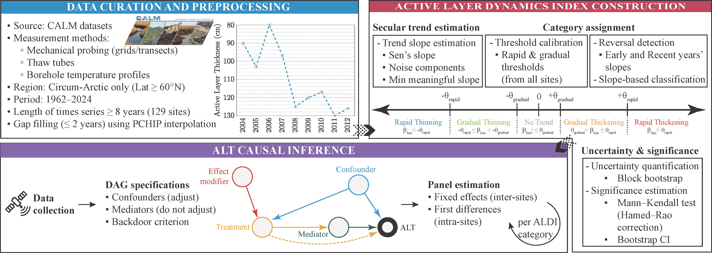

# Active Layer Dynamics Index (ALDI)

Active layer thickness (ALT), the depth of summer thaw above permafrost, is a key indicator
of how permafrost responds to a warming climate. This repository builds a circumarctic
multi-source ALT dataset and the Active Layer Dynamics Index (ALDI) computed from it:

- **ALT target (step 1).** End-of-season ALT from probing grids, thaw tubes and
  ground-temperature profiles of about 35 sources, merged into one series per site, with
  quality flags. Run 7 (2 November 2026): 359 sites and 6,567 valid site-years.
- **ALDI A (step 3).** One hierarchical Bayesian model of all series (log ALT, AR(1) noise
  per method family, shared region-year anomalies, partial pooling of site trends within
  250 km regions, lower-bound years as censored values). Each site gets a rate of change in
  % per decade, its 90 % interval and a class: rapid or gradual thickening, stable, gradual
  or rapid thinning, or indeterminate (the record cannot decide). Applied to 229 sites
  north of 60 N with at least 10 years over 12 or more years since 1990.
- **ALDI B (step 3).** Each site's trend split into the part expected from the air
  temperature record (thawing degree-days, Stefan's law, ERA5-Land corrected to the site
  elevation) and a residual that the modelled weather does not explain, in seven variants
  from this summer's thawing degree-days alone to degree-day memory, winter, snow and rain.
  The residual is a statistical decomposition, not an attribution of cause.

The figure below shows the framework of the earlier version (v4, six classes and
class-stratified causal models on 129 CALM sites, EGUsphere-2026-2639). It is kept for
reference; the current method is described in `docs/3_aldi.md`.

## How to run it

Three scripts, run in this order from this folder. Each one is the complete code of its
step, with its settings at the top.

| Step | Command | Time | Reads | Writes |
|---|---|---|---|---|
| 1. ALT target | `py -3.12 1_alt_target.py` | ~3 min | `data/raw/alt_sources/` | `data/1_alt_target/` |
| 2. Covariates (Earth Engine) | `py -3.12 2_covariates.py` | ~2 h the first time | step 1 | `data/2_covariates/` |
| 3. ALDI A + B | `py -3.12 3_aldi.py` | ~10-30 min | steps 1 and 2 | `data/3_aldi/` |

- **Step 1** rebuilds the ALT target from the raw files on the computer. `--download` first
  fetches new or missing source files (NEON then needs your token for that terminal:
  `$env:NEON_TOKEN="..."`; it is never saved).
- **Step 2**, one-time setup: `py -3.12 -m pip install earthengine-api geopandas scikit-learn`,
  then `earthengine authenticate` (browser sign-in), then the first run with
  `--project YOUR-EE-PROJECT-ID` (remembered in `data/ee_project.txt`). `--test` checks 3
  sites first. The default gets what ALDI B needs; `--all` gets every variable and merges
  them for the causal analysis. A stopped run continues where it left off.
- **Step 3** options: `--power` (NASA POWER temperature, robustness run), `--validate`
  (simulation check, 1-2 h), `--sensitivity` (twelve runs that each change one choice:
  censored prior, undated surveys, site quality, disturbed plots, one series per place,
  2000-2024 window, record length, region size; 30-40 min), `--spatial` (only the spatial
  checks on the existing results, about a minute; needs geopandas for the permafrost-map
  part). `--no-main` skips the main fit and adds the other runs to the existing
  `data/3_aldi`. Everything at once: `py -3.12 3_aldi.py --power --sensitivity --validate`.
- A new output replaces the current one only when its run finished without error. The
  output before it is kept in `data/previous/` (one copy).
- Every script prints its options with `-h`. Python 3.12 is needed (on this laptop `py -3.12`;
  plain `python` is a 3.15 without some of the packages). A script started with a Python that
  lacks a package stops at once and says what to install.

## What is where

| | |
|---|---|
| `1_alt_target.py` | ALT from every source and method (probing grids, thaw tubes, ground temperatures): download, read, merge, flags. The list of source files is at its end |
| `2_covariates.py` | climate, snow, soil, vegetation, fire, terrain and permafrost-map variables per site and year, from Google Earth Engine |
| `3_aldi.py` | ALDI v6: A (hierarchical trends and classes) and B (trend expected from air temperature and residual), the v5.2 comparison, the simulation check |
| `data/` | everything that is data. Only on the computer, not on GitHub: `raw/` (downloads: ALT sources, permafrost map, NASA POWER), `1_alt_target/`, `2_covariates/`, `3_aldi/`, `previous/` |
| `docs/` | the method of each step in detail (`1_alt_target.md`, `2_covariates.md`, `3_aldi.md`) and the list of covariate columns |
| `extras/` | earlier and exploratory work, not part of the current analysis: `ALDI_causality.ipynb` (the class-stratified causal analysis of v4, kept for reference), `IndexVX_FiguresScriptV2.m` (v4 figures, MATLAB), and the v4 paper version: `ALDI_Calculation_final.ipynb` and its data in `v4_data/` |
